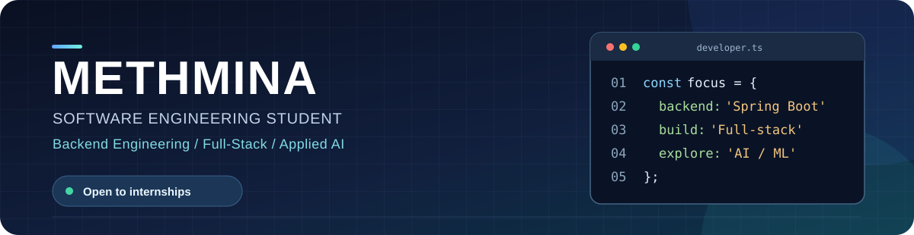
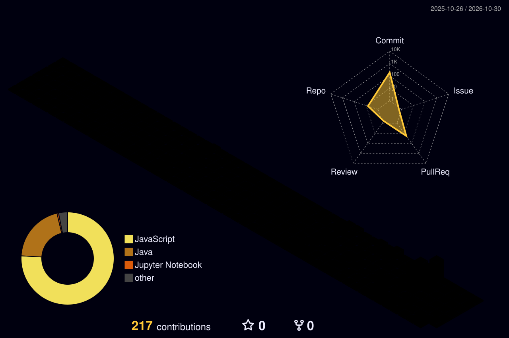

  

   

  
<strong>Building reliable systems and useful products, one thoughtful iteration at a time.</strong>

  

    <a href="#about">About</a> ·
    <a href="#featured-projects">Projects</a> ·
    <a href="#tech-stack">Tech stack</a> ·
    <a href="#github-activity">Activity</a> ·
    <a href="#connect">Connect</a>
  

---

## About

I'm a software engineering student based in **Sri Lanka**, completing a **Higher Diploma in Computing & Software Engineering** and planning to pursue a **BSc (Hons) in Software Engineering**.

I enjoy building backend services, connecting systems end to end, and exploring practical uses for AI and machine learning. I'm looking for a **Software Engineering Internship** where I can contribute to real products and keep growing with a team.

> **Currently building:** backend systems, full-stack apps, and AI-powered projects 
> **Currently learning:** system design, testing, architecture, and DevOps

## Featured projects

### [StockPilot ↗](https://github.com/Methmina1/Stock-Pilot)

**AI-powered stock analysis and prediction** · Final Higher Diploma project

A financial analytics app that brings market visualizations, machine learning predictions, and decision support into one interface.

- Explore stock trends, technical indicators, and financial data.
- Generate forecasts and BUY / HOLD / SELL decision support.
- Explain predictions with SHAP and LIME.
- Evaluate performance through backtesting and live WebSocket updates.

`Python` · `FastAPI` · `React` · `PostgreSQL` · `Pandas` · `NumPy` · `WebSockets` · `Docker`

---

### Nova AI

**AI-assisted HR and project management** · Full-stack exploration

A project exploring how LLMs and intelligent workflows can support HR processes and project management.

- Explore agent and workflow orchestration with LangChain and LangGraph.
- Integrate LLM capabilities through the DeepSeek API.
- Build the application with the MERN stack.

`MongoDB` · `Express.js` · `React` · `Node.js` · `LangChain` · `LangGraph`

## Tech stack

<b>Languages & backend</b>

 

<b>Frontend & databases</b>

 

<b>AI, data & developer tools</b>

 

## What I'm exploring

- **Backend & architecture:** REST API design, authentication, database integration, SOLID, and system design.
- **AI & data:** predictive modeling, explainable AI, and intelligent workflows.
- **Software craftsmanship:** testing, maintainability, Git workflows, Docker, and CI/CD fundamentals.

## GitHub activity

  

The calendar is generated by <a href="./.github/workflows/profile-3d.yml">GitHub Actions</a> after the workflow runs.

## Connect

I'm open to software engineering internships and collaborative projects. The best place to reach me is [GitHub @Methmina1](https://github.com/Methmina1).

  

---

  Always learning · Always building · Always improving

